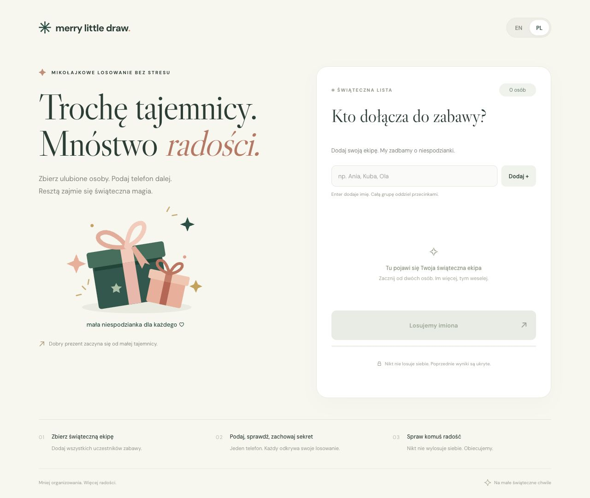

<div align="center">

# 🎁 Merry Little Draw

### Secret Santa, without the slips of paper.

Bring your favorite people together, add their names, and pass one phone around.<br>
Everyone privately discovers who they’re buying a gift for—with a little confetti along the way.

**2–50 people** &nbsp; · &nbsp; **English & Polish** &nbsp; · &nbsp; **No accounts** &nbsp; · &nbsp; **Made for mobile**

[How it works](#how-it-works) · [Run locally](#run-locally) · [Build & deploy](#build--deploy) · [Translations](#translations)

</div>

---

## A little mystery. A lot of joy.

A simple Secret Santa tool for family gatherings, friends, and office gift exchanges.
Set up the whole group on one device, then let each person reveal their recipient
in turn. Nobody draws themselves, and everyone receives a gift from exactly one
person. Once a reveal is dismissed, the next person can’t browse back to it.



<p align="center"><sub>Desktop preview · Polish interface. Designed for passing a phone around, with room to shine on a bigger screen.</sub></p>

## How it works

1. **Make your merry list.** Add 2–50 names individually, or paste a group separated by commas, semicolons, or new lines. Use a surname or nickname when two people share a name.
2. **Start the draw.** Everyone gets one recipient, and nobody gets themselves.
3. **Pass the phone.** The screen names the person whose turn it is. A five-second pause gives everyone time to hand over the device and look away.
4. **Reveal your person.** That person taps the button, sees who to buy for, and gets a burst of confetti.
5. **Remember, then move on.** Next clears the reveal and starts the next handoff. The last person finishes the draw; there’s no list of everyone’s results at the end.

> **One group, one phone, one tab.** Keep the same browser tab open until everyone has drawn.

## Made for the moment

| Feature | What it means for your group |
| --- | --- |
| 🎲 Fair draws | Every recipient appears once. No self-draws, even with just two people. |
| 🤫 Private reveals | Next removes the previous result. Refreshing or returning to the page moves forward rather than recovering it. |
| 🌍 English & Polish | Switch languages at any point without resetting the draw or its cooldown. Your language preference is remembered. |
| 📱 Comfortable on any screen | A mobile-first layout, fixed card and action positions, and gentle ease-out transitions. |
| ✨ A little celebration | Confetti on reveal, with animations disabled when reduced motion is preferred. |
| 🏡 Browser-local | No sign-up or backend. Participant names and pairings stay in the browser rather than being uploaded. |

<details>
<summary><strong>How the draw and privacy work</strong></summary>

Draws use cryptographic browser randomness and uniformly sample valid derangements:
each person gives to one other person, each recipient appears exactly once, and
nobody is assigned themselves.

Pending pairings are stored in the current tab’s **session storage**. Each pairing
is removed from storage **before** it is revealed. Next clears the on-screen
result; refreshing or leaving a revealed screen advances to the next person.
The app creates no browser history entries for draw steps and never shows a
pairing summary.

The language preference uses **local storage**, separately from the draw session.
If session storage is unavailable, the app warns you to keep the page open.
Treat closing the tab as ending the draw; browser session-restore behavior can vary.

This protects the shared-phone party flow. It does not protect against someone
inspecting browser developer tools or taking screenshots. Google Fonts enhance
the typography; system fonts are used if they’re unavailable.

</details>

## Run locally

Use **Node.js 24.15+ (24.x)**, or another supported version listed in `package.json`.

```sh
npm ci
npm run dev
```

Open [127.0.0.1:5173](http://127.0.0.1:5173). React and Vite handle the interface;
no backend or environment variables are required.

## Build & deploy

```sh
npm test          # Draw rules, privacy, React interactions, and localization
npm run build    # Create the static site in dist/
npm run preview  # Preview the production build locally
```

Deploy the contents of `dist/` to a static host. Build output stays out of Git;
commit the site’s source code instead. The production preview uses the same
local port as the development server, so stop one before starting the other.

The test suite covers unique recipients, name validation, five-second cooldowns,
session restoration, reveal privacy, translations, storage failures, confetti,
and reduced motion.

## Inside the app

| Location | Purpose |
| --- | --- |
| `src/App.jsx` | React state, event handlers, and the shared translation provider |
| `src/components/` | Page chrome, draw stages, icons, and layout motion |
| `src/draw.mjs` & `src/game.mjs` | Random assignments, validation, and draw transitions |
| `src/session.mjs` | Persistence and restoration of future pairings |
| `src/i18n.js` & `src/locales/` | Localization setup and English/Polish dictionaries |
| `src/styles.css` | Responsive styling and stable layout |
| `tests/` | Draw logic, React flow, and localization checks |

The card and primary action keep the same dimensions throughout the draw.
The participant list scrolls in its reserved area, and validation messages have
their own space. Motion animates the current layout without retaining an outgoing
copy of a private reveal.

## Translations

Localization uses [i18next](https://www.i18next.com/) and
[react-i18next](https://react.i18next.com/). Translation strings live in
`src/locales/en/translation.json` and `src/locales/pl/translation.json`.
Language state belongs to i18next, independently of the draw session.

Use the standard hook in any component under `App`:

```jsx
const { t } = useTranslation();

t("setupTitle");
t("remove", { name });
t("people", { count });
```

i18next handles interpolation and the language’s standard plural forms.
Keep participant names in React text or attribute expressions. Use
`<Trans i18nKey="headline" />` for translations containing `<br/>` or `<em>`
elements, without parsing HTML yourself.

The browser detector checks the saved `merry-language` preference first, then
browser languages, with English as the fallback. Region codes such as `pl-PL`
resolve to the base language. Both dictionaries ship with the app, so switching
needs no network request. Page title, HTML language, and accessibility labels
follow the selected language.

**Adding a language:** create its JSON dictionary, register it in `resources` in
`src/i18n.js`, and include its plural forms. The supported language list and
switcher derive from that registry. Run `npm test` to check message coverage,
interpolation parity, detection, fallback, and preference persistence.

---

<p align="center">Less organizing. More merry. ✳</p>
